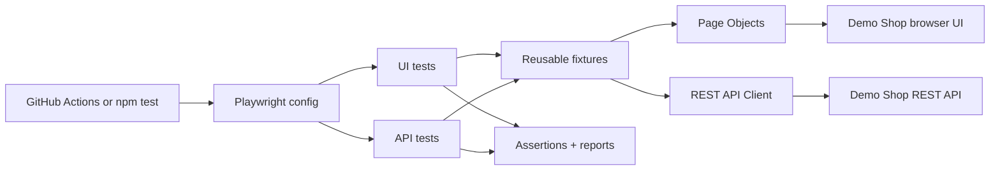

# Playwright UI + API Test Automation Framework

**Portfolio project | TypeScript • Playwright • Page Object Model • REST API • CI/CD**

A **real, runnable personal-project framework**, not just an assortment of test case scripts. It includes its own small e-commerce practice application so that UI, API, negative, and regression tests have a consistent target.

> **Purpose:** Practice building and maintaining automation architecture. The demo shop uses intentionally fake logins, products and orders. This is **not employer experience** and the included app is **not production commerce software**.

## Included testing types

| Testing type | Implementation |
| --- | --- |
| UI / end-to-end / functional | Browser login, search, filtering, cart, checkout and logout |
| API | Authentication, catalog and order endpoints with HTTP assertions |
| Smoke | Critical tests tagged `@smoke` |
| Regression | Broader scenarios tagged `@regression` |
| Positive and negative | Correct credentials, wrong credentials, invalid/missing tokens, invalid quantities |
| Data-driven | Multiple product search inputs using one test pattern |
| Cross-browser | UI tests in Chromium, Firefox and WebKit |
| Basic accessibility | Login form labels and keyboard tab navigation |
| Responsive layout | Small-screen catalog/cart test |
| Standalone API integration | Node's built-in test runner verifies health, auth, products, orders and invalid JSON |

**Not claimed:** production security audits, load/stress testing, full accessibility compliance, or native mobile-app testing.

## Framework architecture



### Key folders

```text
playwright-ui-api-automation-framework/
├── .github/workflows/playwright.yml  # CI: checks + browser tests
├── demo-app/
│   ├── server.mjs                   # No-database local HTTP API
│   └── public/                     # HTML, CSS, JavaScript frontend
├── src/
│   ├── data/test-data.ts            # Fake users and expected products
│   ├── fixtures/test.ts             # Reusable Playwright fixtures
│   ├── pages/                       # Login and Store Page Objects
│   └── services/shop-api.ts         # Typed API client
├── tests/
│   ├── api/                         # Playwright HTTP tests
│   ├── ui/                          # Browser + accessibility tests
│   └── server/                      # Dependency-free Node API checks
├── docs/
│   ├── BEGINNER_GUIDE.md            # Understand architecture step by step
│   ├── TEST_PLAN.md                 # Detailed test case matrix
│   └── GITHUB_PUBLISH.md            # Publish as a public GitHub repo
├── playwright.config.ts             # Browsers, projects, traces and reports
└── package.json                     # Install and test commands
```

## Requirements and quick start

- **Node.js 20 or newer**, npm, and Git if you want to publish.
- No database, API key, paid service, or account is required for local testing.

```bash
# After extracting this project, open a terminal in its root folder:
npm install
npx playwright install
npm run test:server     # dependency-free Node integration suite
npm run test:chromium   # UI browser tests in Chromium
npm test                # API once + UI on three browser engines
npm run test:report     # view HTML results
```

Playwright starts the demo server automatically at http://127.0.0.1:4173 while the suite is running. If you want to explore manually:

```bash
npm run demo:start
```

Then open http://127.0.0.1:4173 and sign in with `demo@example.com` / `Password123!` (fake credentials only for this demo).

## QA Control Center — real execution dashboard

The repository now includes a **React + Vite dashboard** backed by a local Node.js orchestration API. It displays actual Playwright run history, pass rates, suite execution, per-test failures, logs and HTML reports. No sample pass/fail counts are hard-coded. Reports and history are stored on your own computer, not uploaded by the dashboard.

```bash
npm install                  # root test-runner dependencies
npx playwright install      # one-time browser setup
npm run dashboard:setup     # install dashboard UI dependencies
npm run dashboard           # build UI and start local API + web server
```

Open **http://127.0.0.1:4300**. The dashboard runs *only on localhost* and runs one allowlisted suite at a time. For development, run `npm run dashboard:start` and `npm run dashboard:dev` in two terminals, then open **http://127.0.0.1:5173**.

See **[Dashboard guide](docs/DASHBOARD.md)** for setup, architecture, security, and result semantics. Module 7 adds **per-project CSV/JSON exports, run comparisons, flaky/retry counts, and confirmed history deletion**; see **[Reporting and Analytics](docs/REPORTING_ANALYTICS.md)**.

## Northline Goods — shopping application and integrated UX states

The bundled `demo-app/` uses a **steel-grey editorial storefront** with a responsive layout, keyboard-accessible forms, and functional shopping flows. Prices are shown in **Indian rupees (INR)**; the API represents money in integer **paise** (`pricePaise` and `totalPaise`) to avoid floating-point currency arithmetic.

The 10 requested UX conditions are part of real workflows, **not a separate Experience Lab or a set of showcase cards**: empty cart, loading skeletons, catalog error with retry, offline notice, slow-network feedback, empty search results, clipboard-permission fallback, expired checkout session, form validation, and order confirmation. The failure conditions are reproducible through Playwright network interception and browser controls; they are not fabricated failures shown to shoppers.

See **[store design and real-state behavior](docs/STORE_DESIGN.md)** and **[the implementation roadmap](docs/ROADMAP.md)**. The corresponding browser tests are in `tests/ui/states.spec.ts`.

To restore the project later, `commands.txt` contains the full `git clone` / `npm ci` sequence in addition to the earlier local commands.

## Multi-project QA runner — Modules 1 and 2

The validated **project registry** (Module 1) now feeds a **project-aware Playwright runner** (Module 2). Two independent local fixtures have runnable tests: **Northline Goods** (hybrid UI/API) and **Independent Sample API** (API-only). The disabled `starter-api` profile remains a documentation template.

```bash
npm run projects:validate
npm run test:server
node scripts/run-project.mjs --project northline-goods --environment local --suite smoke --browser chromium --dry-run
node scripts/run-project.mjs --project northline-goods --environment local --suite smoke --browser chromium
npm run test:sample-api
```

The original `npm test` workflow is preserved. In the dashboard, existing Run buttons still default to Northline; the backend accepts explicit `projectId` and `environment` for selected runs. The visual project switcher and project-level analytics are planned for **Module 6**.

**Safety boundary:** Module 2 only executes explicitly configured local loopback fixtures. Disabled, remote, read-only, unsupported and arbitrary script/path selections are blocked. Authorized external website/API execution needs the reusable adapters and safety policy planned for Modules 3–5. See [Module 2 runner guide](docs/PROJECT_RUNNER.md), [project profiles](docs/PROJECT_PROFILES.md), and [implementation roadmap](docs/MODULE_IMPLEMENTATION_PLAN.md).


## Module 4 — reusable REST API automation

The shared API testing library in `src/api/` now supports project-specific HTTP requests, bearer-token and API-key auth, positive/negative tests and a limited runtime JSON contract validator. `projects/sample-api/` has a separate deterministic REST target and real integration tests. The original Northline and Sample Website suites are unchanged.

```bash
npm run test:sample-api         # Sample REST API tests, no browser required
npm run test:server             # Node contract + API integration checks
```

See [API automation guide](docs/API_AUTOMATION.md). Only local fixture targets can currently execute; Module 5 is required before authorized external staging/production testing. The JSON contract helper is **not** a complete JSON Schema/OpenAPI implementation.

## Module 5 — isolated data, credentials and approved staging

The runner now has a shared fail-closed execution policy and a **read-only staging mode**. Local Sample API tests demonstrate unique test data with automatic cleanup and a restricted staging simulation with safe GET-only assertions. Remote HTTPS staging execution is possible only for **explicitly authorized** profiles through a separate terminal opt-in; public/production targets are not automatically tested. The dashboard cannot launch remote runs. See **[safe execution and secret handling](docs/SECURE_EXECUTION.md)**.

```bash
npm run test:sample-api-staging  # local staging simulation, safe tests only
```

## Module 6 — Multi-project QA Control Center

The React console now exposes **Project** and **Environment** selectors. Choose Northline Goods, Sample Website, or Sample API; unsupported suites and browser choices are filtered for the selected project. The Overview, historical runs, report links, and suite counts are scoped to **project and environment**. Legacy runs without project metadata appear under Northline/local. There is still one active local run at a time.

The project discovery API returns only safe display metadata, never credentials or target URLs. The API runner keeps its server-side safety checks: external HTTPS staging requires separate authorization, and production remains blocked. To test the dashboard UI itself, run `npm run dashboard:build` followed by `npm run test:dashboard`.

See **[the dashboard guide](docs/DASHBOARD.md)** for scope and limitations. The next planned phase is **Module 7: deeper reporting and analytics**.

## Useful test commands

| Command | Purpose |
| --- | --- |
| `npm test` | Run Playwright API tests once and UI tests on all three browsers |
| `npm run test:ui` | Run UI tests (Chromium / Firefox / WebKit) |
| `npm run test:api` | Run Playwright API tests |
| `npm run test:server` | Run direct Node API integration tests, no npm install needed |
| `npm run test:smoke` | Run tagged critical-path smoke tests |
| `npm run test:regression` | Run tagged regression suite |
| `npm run test:negative` | Check tagged invalid-input scenarios |
| `npm run test:accessibility` | Run basic accessibility-related browser tests |
| `npm run test:chromium` | Run Chromium UI tests for fast local feedback |
| `npm run test:headed` | Watch Chromium browser interactions |
| `npm run test:debug` | Step through tests with Playwright Inspector |
| `npm run test:report` | Open the HTML test report |
| `npm run typecheck` | TypeScript static type checking |
| `npm run lint` | ESLint validation |
| `npm run format` | Apply Prettier formatting |

Run one test file:

```bash
npx playwright test tests/ui/catalog.spec.ts --project=chromium
```

## What makes this a framework instead of just tests?

- The **Page Object Model** keeps UI selectors in reusable classes, not copied across tests.
- **Fixtures** create and inject page objects and an API service, so test cases focus on behaviors.
- **Test data** is separated from implementation, avoiding hard-coded values scattered across files.
- The **configuration** controls browser projects, setup, timeouts, retries, and diagnostic evidence.
- **Reports** include HTML and JUnit output, plus screenshots/videos/traces on failing or retried tests.
- **GitHub Actions CI** repeats the checks automatically on pushes and pull requests.
- **Independent test scenarios** reduce run-order dependencies and improve debugging.

## CI/CD and reports

The workflow at `.github/workflows/playwright.yml` is triggered on `main` pushes, pull requests and manual dispatch. It executes typecheck, lint and standalone API tests; then installs Playwright browsers and runs the whole suite. It uploads available reports as a workflow artifact even when tests fail.

The project uses a small **local server** rather than testing a public production website. That makes results deterministic and safe to practice on.

## Learn it, demonstrate it, publish it

- **[Beginner-friendly architecture and examples](docs/BEGINNER_GUIDE.md)** — read this first.
- **[Test plan and scenario coverage](docs/TEST_PLAN.md)** — exact cases and expected results.
- **[Publish as a public GitHub repository](docs/GITHUB_PUBLISH.md)** — step-by-step instructions.
- **[Verification record](docs/VERIFICATION.md)** — which checks genuinely passed and which remain pending.
- **[Contributing guide](CONTRIBUTING.md)** — how to add features and tests.

### Portfolio description (once you have run and maintained it)

> Built a personal Playwright + TypeScript test automation framework for a demo commerce app, using reusable Page Objects and fixtures, a REST API client, UI/API smoke and regression tests, cross-browser coverage, failure diagnostics and GitHub Actions CI.

If an application form was submitted before this project existed, be honest about the timing if asked. The repo demonstrates a **new personal project**, not prior job experience.

## License

MIT — see [LICENSE](LICENSE).
