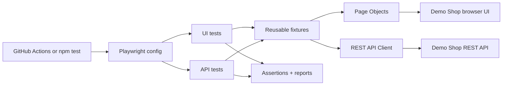

# Playwright UI + API Test Automation Framework

**Portfolio project | TypeScript • Playwright • Page Object Model • REST API • CI/CD**

A **real, runnable personal-project framework**, not just an assortment of test case scripts. It includes its own small e-commerce practice application so that UI, API, negative, and regression tests have a consistent target.

> **Purpose:** Practice building and maintaining automation architecture. The demo shop uses intentionally fake logins, products and orders. This is **not employer experience** and the included app is **not production commerce software**.

## Included testing types

| Testing type | Implementation |
| --- | --- |
| UI / end-to-end / functional | Browser login, search, filtering, cart, checkout and logout |
| API | Authentication, catalog and order endpoints with HTTP assertions |
| Smoke | Critical tests tagged `@smoke` |
| Regression | Broader scenarios tagged `@regression` |
| Positive and negative | Correct credentials, wrong credentials, invalid/missing tokens, invalid quantities |
| Data-driven | Multiple product search inputs using one test pattern |
| Cross-browser | UI tests in Chromium, Firefox and WebKit |
| Basic accessibility | Login form labels and keyboard tab navigation |
| Responsive layout | Small-screen catalog/cart test |
| Standalone API integration | Node's built-in test runner verifies health, auth, products, orders and invalid JSON |

**Not claimed:** production security audits, load/stress testing, full accessibility compliance, or native mobile-app testing.

## Framework architecture



### Key folders

```text
playwright-ui-api-automation-framework/
├── .github/workflows/playwright.yml  # CI: checks + browser tests
├── demo-app/
│   ├── server.mjs                   # No-database local HTTP API
│   └── public/                     # HTML, CSS, JavaScript frontend
├── src/
│   ├── data/test-data.ts            # Fake users and expected products
│   ├── fixtures/test.ts             # Reusable Playwright fixtures
│   ├── pages/                       # Login and Store Page Objects
│   └── services/shop-api.ts         # Typed API client
├── tests/
│   ├── api/                         # Playwright HTTP tests
│   ├── ui/                          # Browser + accessibility tests
│   └── server/                      # Dependency-free Node API checks
├── docs/
│   ├── BEGINNER_GUIDE.md            # Understand architecture step by step
│   ├── TEST_PLAN.md                 # Detailed test case matrix
│   └── GITHUB_PUBLISH.md            # Publish as a public GitHub repo
├── playwright.config.ts             # Browsers, projects, traces and reports
└── package.json                     # Install and test commands
```

## Requirements and quick start

- **Node.js 20 or newer**, npm, and Git if you want to publish.
- No database, API key, paid service, or account is required for local testing.

```bash
# After extracting this project, open a terminal in its root folder:
npm install
npx playwright install
npm run test:server     # dependency-free Node integration suite
npm run test:chromium   # UI browser tests in Chromium
npm test                # API once + UI on three browser engines
npm run test:report     # view HTML results
```

Playwright starts the demo server automatically at http://127.0.0.1:4173 while the suite is running. If you want to explore manually:

```bash
npm run demo:start
```

Then open http://127.0.0.1:4173 and sign in with `demo@example.com` / `Password123!` (fake credentials only for this demo).

## QA Control Center — real execution dashboard

The repository now includes a **React + Vite dashboard** backed by a local Node.js orchestration API. It displays actual Playwright run history, pass rates, suite execution, per-test failures, logs and HTML reports. No sample pass/fail counts are hard-coded. Reports and history are stored on your own computer, not uploaded by the dashboard.

```bash
npm install                  # root test-runner dependencies
npx playwright install      # one-time browser setup
npm run dashboard:setup     # install dashboard UI dependencies
npm run dashboard           # build UI and start local API + web server
```

Open **http://127.0.0.1:4300**. The dashboard runs *only on localhost* and runs one allowlisted suite at a time. For development, run `npm run dashboard:start` and `npm run dashboard:dev` in two terminals, then open **http://127.0.0.1:5173**.

See **[Dashboard guide](docs/DASHBOARD.md)** for setup, architecture, security, and result semantics.

## Good Form — redesigned shopping test target

The bundled `demo-app/` now uses a **cool steel-grey editorial storefront** with custom CSS product visuals, stronger responsive composition, and meaningful loading/error/recovery interactions. The core UI locators and REST endpoints used by the existing Playwright suite remain stable.

After signing in, switch to **Experience lab** to inspect the 10 controlled states supplied in the reference video: empty, loading, error, offline, slow network, no results, permission denied, session expired, form validation and success. They are **explicitly labeled reproducible QA fixtures**, not claims about real production network failures.

See **[storefront design rationale, UX states and skill references](docs/STORE_DESIGN.md)**. The new cases in `tests/ui/states.spec.ts` check the 10 fixtures and recovery behaviors. Run `npm run demo:start` to explore at `http://127.0.0.1:4173`.

To restore the project later, the original `commands.txt` now includes the exact `git clone` / `npm ci` commands without removing any of your existing notes.

## Useful test commands

| Command | Purpose |
| --- | --- |
| `npm test` | Run Playwright API tests once and UI tests on all three browsers |
| `npm run test:ui` | Run UI tests (Chromium / Firefox / WebKit) |
| `npm run test:api` | Run Playwright API tests |
| `npm run test:server` | Run direct Node API integration tests, no npm install needed |
| `npm run test:smoke` | Run tagged critical-path smoke tests |
| `npm run test:regression` | Run tagged regression suite |
| `npm run test:negative` | Check tagged invalid-input scenarios |
| `npm run test:accessibility` | Run basic accessibility-related browser tests |
| `npm run test:chromium` | Run Chromium UI tests for fast local feedback |
| `npm run test:headed` | Watch Chromium browser interactions |
| `npm run test:debug` | Step through tests with Playwright Inspector |
| `npm run test:report` | Open the HTML test report |
| `npm run typecheck` | TypeScript static type checking |
| `npm run lint` | ESLint validation |
| `npm run format` | Apply Prettier formatting |

Run one test file:

```bash
npx playwright test tests/ui/catalog.spec.ts --project=chromium
```

## What makes this a framework instead of just tests?

- The **Page Object Model** keeps UI selectors in reusable classes, not copied across tests.
- **Fixtures** create and inject page objects and an API service, so test cases focus on behaviors.
- **Test data** is separated from implementation, avoiding hard-coded values scattered across files.
- The **configuration** controls browser projects, setup, timeouts, retries, and diagnostic evidence.
- **Reports** include HTML and JUnit output, plus screenshots/videos/traces on failing or retried tests.
- **GitHub Actions CI** repeats the checks automatically on pushes and pull requests.
- **Independent test scenarios** reduce run-order dependencies and improve debugging.

## CI/CD and reports

The workflow at `.github/workflows/playwright.yml` is triggered on `main` pushes, pull requests and manual dispatch. It executes typecheck, lint and standalone API tests; then installs Playwright browsers and runs the whole suite. It uploads available reports as a workflow artifact even when tests fail.

The project uses a small **local server** rather than testing a public production website. That makes results deterministic and safe to practice on.

## Learn it, demonstrate it, publish it

- **[Beginner-friendly architecture and examples](docs/BEGINNER_GUIDE.md)** — read this first.
- **[Test plan and scenario coverage](docs/TEST_PLAN.md)** — exact cases and expected results.
- **[Publish as a public GitHub repository](docs/GITHUB_PUBLISH.md)** — step-by-step instructions.
- **[Verification record](docs/VERIFICATION.md)** — which checks genuinely passed and which remain pending.
- **[Contributing guide](CONTRIBUTING.md)** — how to add features and tests.

### Portfolio description (once you have run and maintained it)

> Built a personal Playwright + TypeScript test automation framework for a demo commerce app, using reusable Page Objects and fixtures, a REST API client, UI/API smoke and regression tests, cross-browser coverage, failure diagnostics and GitHub Actions CI.

If an application form was submitted before this project existed, be honest about the timing if asked. The repo demonstrates a **new personal project**, not prior job experience.

## License

MIT — see [LICENSE](LICENSE).
