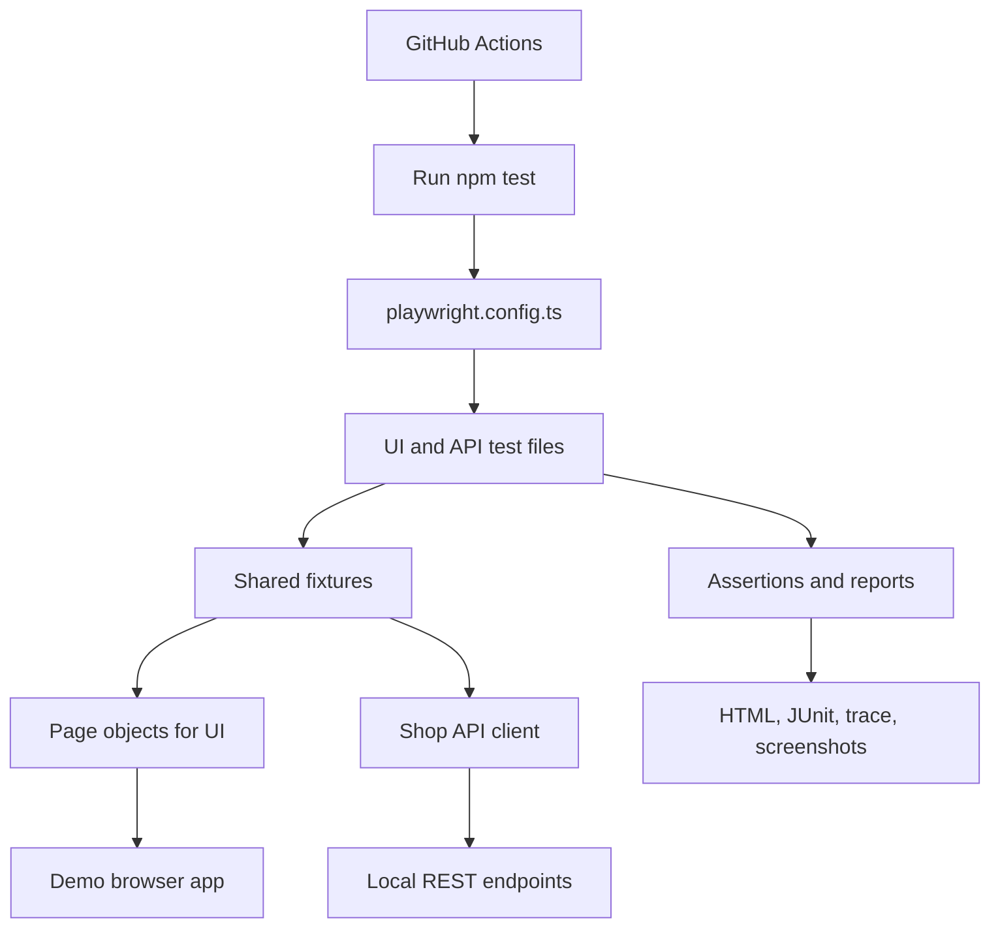

# Beginner's guide: how this test automation framework works

This guide explains the project from zero experience. Run the project yourself before describing it as a project you have built/maintained.

## 1. What is an automation framework?

A **test case** says what behavior should work. A **test automation framework** defines how tests are organized, executed, supplied with data, reused, reported, and run automatically on every code change.

Here, Playwright is the test runner. TypeScript is the programming language. The Page Object Model (POM), custom fixtures, API client, test data, configuration, commands, reports, and GitHub workflow together form our reusable framework.

The shop is a **local practice application**, included because reliable test automation needs something real and deterministic to test. It intentionally has fake credentials and in-memory orders.

## 2. Architecture, simply explained



- **`playwright.config.ts`**: browsers, timeouts, retries, automatic server startup, reporters.
- **`src/pages/`**: selectors and UI actions, such as `login()` and `addProduct()`.
- **`src/fixtures/test.ts`**: constructs fresh page objects and API clients per test.
- **`src/services/shop-api.ts`**: calls REST endpoints; test cases assert the response.
- **`src/data/test-data.ts`**: fake users and expected inventory values.
- **`tests/ui/`**: actions in a real browser and checks of visible results.
- **`tests/api/`**: sends HTTP requests and validates statuses, errors and data.
- **`tests/server/`**: direct Node.js API integration tests that don't require npm packages.
- **`.github/workflows/playwright.yml`**: repeats checks automatically on pushes and pull requests.

## 3. What happens when one UI test runs?

Example: `checkout confirms an order and empties cart`.

1. Playwright starts the shop server (unless `BASE_URL` is configured).
2. A new, independent browser context starts for the test.
3. The login Page Object types fake credentials and clicks **Sign in**.
4. The Store Page Object clicks **Add to cart** for a water bottle.
5. The Store Page Object clicks **Place order**.
6. The frontend calls `POST /api/orders` and receives an order confirmation.
7. Playwright asserts that the confirmation is shown and the cart is empty.
8. The test finishes; Playwright records results, and on failure can capture a screenshot/video/trace.

## 4. What happens when an API test runs?

Example: `authorized order has calculated total`.

1. `shopApi.login()` sends `POST /api/auth/login` with fake credentials.
2. The response is checked for HTTP `200` and a bearer token.
3. `shopApi.createOrder()` sends two products and the token.
4. The test expects HTTP `201`, `status: confirmed`, and `totalCents: 6097`.
5. A bad request, authorization failure, or calculation mismatch fails the test.

**Why two types?** API tests isolate backend behavior and run quickly. UI tests verify the full user experience in a browser. Both are needed because a valid API does not guarantee a working interface.

## 5. Types of testing included

| Testing type | Meaning | Example in this repository |
| --- | --- | --- |
| Functional | Does a feature work as intended? | Add product to cart and check total |
| UI / end-to-end | Does the browser journey work? | Sign in → add to cart → checkout |
| API | Does the HTTP service behave correctly? | Login, catalog search, create order |
| Smoke | Quick checks of important features | `@smoke` login, catalog, order |
| Regression | Rerun coverage after changing code | `@regression` tagged suite |
| Positive | Correct input should work | Valid credentials get a token |
| Negative | Bad input should be safely rejected | Wrong password, missing token, bad quantity |
| Data-driven | Reuse one test structure with inputs | Search for mouse and bottle |
| Cross-browser | Verify in browser engines | Chromium, Firefox, WebKit |
| Basic accessibility | Check semantic controls and keyboard focus | Labels and tab order |
| Responsive | Check smaller viewport | Mobile-width catalog and cart |
| API integration | Check application/server behavior together | Standalone Node.js tests |

**Not included:** load/performance testing, penetration testing, full WCAG audits, mobile-native apps, or production monitoring. Do not claim those are covered.

## 6. Run it on your own computer

Install Node.js 20 or newer, then open a terminal in the unzipped project directory:

```bash
npm install
npx playwright install
npm run test:server
npm run test:chromium
npm test
npm run test:report
```

Windows users may use PowerShell or VS Code's terminal. `npm run test:server` doesn't need Playwright's browser download. `npm run test:chromium` is quicker for debugging; `npm test` covers all three browser engines (with API tests run once in a separate project).

Useful filtered commands:

```bash
npm run test:smoke
npm run test:regression
npm run test:negative
npm run test:ui
npm run test:api
npm run test:accessibility
npm run test:headed
```

If `npm test` fails at first, inspect the failing assertion, verify dependencies/browsers installed, and read the HTML report. Never call tests “passing” without actually running them.

## 7. How to extend the framework yourself

A beginner-friendly enhancement:

1. Add a fourth catalog item to `demo-app/server.mjs`.
2. Update expected catalog data in `src/data/test-data.ts`.
3. Add a new case to the search scenarios in `tests/ui/catalog.spec.ts`.
4. Run the test. If it fails, inspect the reason and fix the behavior or assertion.
5. Commit the change and observe the GitHub Actions run.

A more advanced enhancement: add an **order history** API endpoint, a Store Page Object method, and both positive and negative tests. That would demonstrate genuine continued ownership rather than only uploading starter code.

## 8. Explain this project in an interview

> “I built and maintain a personal automation framework around a small e-commerce practice application. I chose Playwright and TypeScript, structured UI actions using the Page Object Model, provided reusable fixtures and API clients, and separated UI and API test suites. I added smoke and regression tags, negative and data-driven tests, three browser configurations, diagnostics, and GitHub Actions. I run the tests and use failures to improve the framework.”

Use this explanation **only after you have genuinely studied, run, and maintained the project**. If asked when it was created, give the real date. Do not describe it as employer work or something completed before an earlier application submission.
